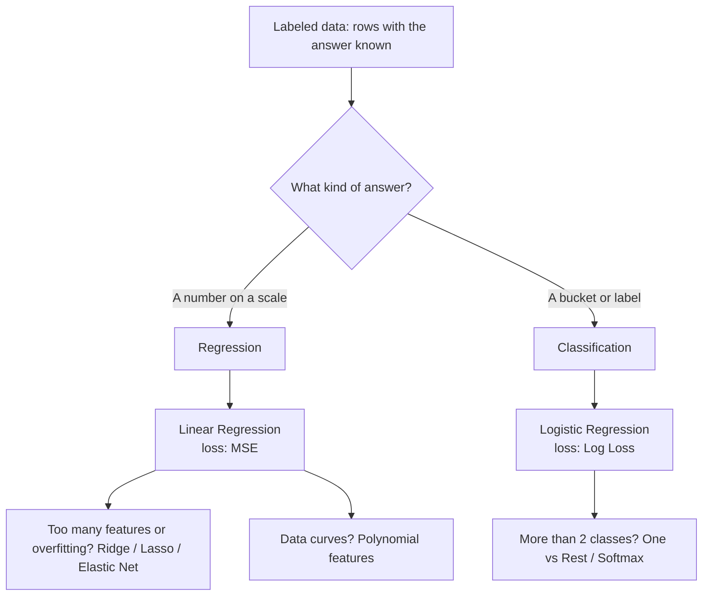
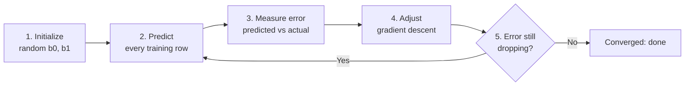
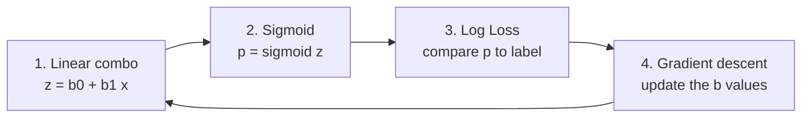
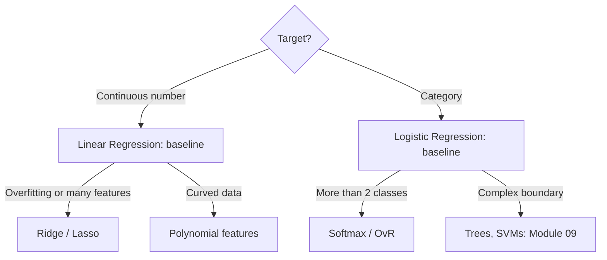

# Lab 06 Brief: Regression and Classification

**Course:** ITAI 1371 &nbsp; **Due:** Wed Oct 14, 2026, 11:59 PM CT &nbsp; **Points:** 100

This brief explains every idea in the Module 06 slides and the Lab 06 notebook. Each idea has three parts:

* **In plain words:** the idea in everyday language.
* **In real terms:** the technical version you would say in class or write in your notebook.
* **Tie to your midterm:** how the same idea showed up in your stroke project.

Nothing here answers the notebook for you. The knowledge checks, the code, and the journals are yours to write. Use this to understand, then close it and do the work.

---

## The big picture



In the lab you build one of each, on the Titanic dataset:

| Task | Type | Predict | Using | Score with |
|---|---|---|---|---|
| Task 1 | Regression | `Fare` (ticket price) | `Age`, `Pclass` | Mean Squared Error |
| Task 2 | Classification | `Survived` (0 or 1) | `Age`, `Pclass`, `Sex` | Accuracy |

---

## 1. Supervised learning

**In plain words:** You learn from examples where the answer is already written down, like studying with an answer key. Later you guess the answer for new examples that have no key.

**In real terms:** Supervised learning trains a model on labeled data, meaning each row has input features (X) and a known target (y). The model learns a mapping from X to y and is then judged on rows it never saw.

**Tie to your midterm:** Your stroke dataset (5,110 rows) was labeled: every patient had a `stroke` value of 0 or 1. That column is the answer key, so the stroke data is a supervised learning problem.

---

## 2. Regression vs classification (the core difference)

**In plain words:** Ask yourself one question about the answer column. Can you measure it with a ruler? That is regression. Can you sort it into separate buckets? That is classification.

**In real terms:** Regression predicts a continuous numeric target (price, temperature, minutes). Classification predicts a discrete class label (spam or not spam, survived or died, cat or dog or bird). The type of target decides the model, the loss, and the metric.

| | Regression | Classification |
|---|---|---|
| Question it answers | How much? How many? | Which one? Yes or no? |
| Example output | $45,000, 3.2 degrees, 23 minutes | "Spam", "Cat", "High Risk" |
| Lab example | Titanic `Fare` | Titanic `Survived` |

**Tie to your midterm:** `stroke` is 0 or 1, so predicting it is **classification**. Prof Rao's feedback made this point: stroke is the target for classification. If you predicted `avg_glucose_level` or `bmi` instead, that would be regression, because those are measured on a scale.

> **Guiding question:** The Titanic dataset has `Survived` coded as 0 and 1. Those are numbers. Why is it still classification and not regression? (Hint: can a passenger be 0.6 survived?)

---

## 3. Linear regression

**In plain words:** Draw the straight line that passes as close as possible to all your dots. To predict, find your spot on the line.

**In real terms:** Linear regression models the target as a weighted sum of features plus a starting value:

`y = b0 + b1*x`

* **Intercept (b0):** where the line crosses the y axis, the prediction when every feature is 0.
* **Slope or coefficient (b1):** how much y changes when x goes up by 1.

The algorithm picks the b values that make the total error as small as possible.

**Tie to your midterm:** You never fit a model in the midterm, you prepared data for one. But you scaled `age`, `avg_glucose_level`, and `bmi` with StandardScaler. That matters here: when features are on the same scale, their coefficients are easier to compare.

---

## 4. How the best fit line is found

**In plain words:** Start with a guess line. See how wrong it is. Nudge it to be a little less wrong. Repeat until nudging stops helping.

**In real terms:** The slides show five steps:



**Ordinary Least Squares (OLS)** is the math that minimizes the Sum of Squared Errors. Good to know: scikit learn's `LinearRegression` actually solves OLS directly with algebra instead of looping, but the goal (smallest squared error) is identical. Gradient descent is the looping version, and it is how logistic regression gets trained.

**Tie to your midterm:** This is why you only learned the bmi median (28.1) and the scaler settings from the 3,577 training rows. The model also only "learns" from training rows. The 1,533 test rows are for checking, never for adjusting.

---

## 5. Mean Squared Error (MSE)

**In plain words:** For each guess, find how far off you were, square it, then average all of those. Big misses count way more than small misses.

**In real terms:** `MSE = average of (predicted minus actual) squared`

The slides give three reasons for squaring:

1. **No cancellation:** a miss of minus 5 and plus 5 both become 25, so they cannot cancel to zero.
2. **Heavy penalty:** being off by 10 costs 100, being off by 1 costs 1. Big errors are punished hard.
3. **Math friendly:** the square curve is smooth, so the algorithm can find its lowest point easily.

**RMSE** is the square root of MSE. It puts the error back in the original units (dollars, for Fare), which is easier to explain.

**Tie to your midterm:** Your bmi column had an extreme value of 97.6. That is exactly the kind of outlier that MSE punishes heavily and that can drag a regression line. The same reason you used the median (not the mean) to fill bmi blanks applies here: extreme values have outsized pull.

> **Guiding question:** Titanic fares include a few very expensive tickets. What would that do to MSE? Do you expect your fare model to be very accurate with only Age and Pclass?

---

## 6. Multiple linear regression

**In plain words:** Real answers depend on more than one thing. Give each input its own slope and add them up.

**In real terms:** `y = b0 + b1*x1 + b2*x2 + ... + bn*xn`. In the lab, Fare is predicted from two features, `Age` and `Pclass`, so the model learns two coefficients and one intercept.

**Tie to your midterm:** After one hot encoding, your stroke data had many feature columns. Each would get its own coefficient in a linear model.

---

## 7. Reading coefficients (what the numbers mean)

**In plain words:** A coefficient tells you which way a feature pushes the answer and how hard.

**In real terms:**

* **Positive coefficient:** feature goes up, prediction goes up. (Slides: each extra square foot adds $150.)
* **Negative coefficient:** feature goes up, prediction goes down. (Slides: each extra year of house age drops price by $2,000.)
* **Bigger absolute size = stronger influence**, but only fairly comparable when features are on similar scales.

`.coef_` in scikit learn holds these numbers, in the same order as your feature list. `.intercept_` holds b0.

**Tie to your midterm:** Watch the scale trap. `Pclass` is 1, 2, or 3. `Age` runs from under 1 to 80. A coefficient on Pclass means "per one class step," while Age means "per one year." That is why you standardized age, glucose, and bmi in the midterm: so one unit means the same thing for each.

> **Guiding question for knowledge check 2:** Pclass 1 is first class (the most expensive) and Pclass 3 is third class. If fares are higher in first class, which sign would you expect on the Pclass coefficient? Print it and see if your guess holds. Write what you actually see, not what you expected.

---

## 8. Four assumptions of linear regression

**In plain words:** Linear regression works best when the world plays fair in four ways.

**In real terms:**

| Assumption | Plain meaning |
|---|---|
| Linearity | The real relationship is roughly a straight line, not a curve. |
| Independence | Rows do not secretly depend on each other (like days in a time series). |
| Homoscedasticity | The spread of errors stays about the same along the whole line. |
| Normality | The errors (residuals) form a bell curve. |

If these break, predictions get unreliable and you should consider other models.

**Tie to your midterm:** You checked distribution shapes (skew) in the midterm. That same habit, looking at the shape before trusting a model, is what these assumptions ask for.

---

## 9. When linear regression fails

**In plain words:** Three things trip it up: curves, outliers, and inputs that copy each other.

**In real terms:**

* **Non linearity:** a straight line fit to a curve **underfits** ("square peg in a round hole").
* **Outliers:** because MSE squares errors, one extreme point can pull the whole line ("one bad apple").
* **Multicollinearity:** two features carrying the same information confuse the model about who gets credit ("two people shouting the same answer").

**Tie to your midterm:** One hot encoding can create multicollinearity if you keep every category column (the dummy variable trap). Ask yourself whether you used `drop_first` and why.

---

## 10. Why linear regression fails for classification

**In plain words:** A straight line keeps going forever, so it can predict 150% or minus 20% chance. Those make no sense.

**In real terms:** For a 0 or 1 target, linear output is unbounded (minus infinity to plus infinity) and very sensitive to outliers, which shifts the cutoff and causes wrong labels. The fix: squash the output into the range 0 to 1.

**Tie to your midterm:** If you ran a straight line on `stroke`, you would get predictions like 0.03 or minus 0.1 or 1.2, the same "in between value" problem you saw when SMOTE blended stroke into values like 0.4. A 0 or 1 column should not be treated as a smooth number. That was the core of Prof Rao's SMOTE feedback.

---

## 11. The sigmoid function

**In plain words:** A squeezing machine. Put in any number, big or small, and out comes something between 0 and 1 that you can read as a chance.

**In real terms:** `sigmoid(z) = 1 / (1 + e^(minus z))`

* Very negative z gives close to 0. Very positive z gives close to 1.
* At z = 0 the output is exactly 0.5.
* The output is read as the probability of the positive class (class 1).

```
probability
1.0 |                 ________
    |              /
0.5 |-----------*-----------   <- z = 0
    |        /
0.0 |_______/
      negative   0   positive   (z)
```

**Tie to your midterm:** For a stroke model, the sigmoid output would be "this patient's estimated chance of stroke."

---

## 12. Logistic regression (a classifier, despite the name)

**In plain words:** Do a linear regression, then pass the answer through the sigmoid squeezer so it becomes a probability. Then pick yes or no.

**In real terms:** Training follows four repeated steps:



It is called "regression" because step 1 is a regression. It is used for **classification** because the final output is a class.

**Tie to your midterm:** This is the natural first model for your stroke data: binary target, interpretable coefficients.

---

## 13. Log Loss (binary cross entropy)

**In plain words:** A scoring rule that punishes you a lot for being confident and wrong.

**In real terms:** `Loss = minus [ y * log(p) + (1 minus y) * log(1 minus p) ]`, where y is the real label and p is the predicted probability. Slide example, when the true answer is 1:

| Prediction p | Loss |
|---|---|
| 0.95 (confident and right) | 0.05 |
| 0.50 (unsure) | 0.69 |
| 0.01 (confident and wrong) | 4.60 |

MSE measures distance. Log Loss measures how good your probabilities are. That is why classification uses Log Loss for training.

---

## 14. Decision threshold

**In plain words:** The probability line where you switch from "no" to "yes." The default is 0.5, but you can move it.

**In real terms:**

* **High threshold (like 0.9):** only say yes when very sure. Fewer false positives. Spam filters do this so real email is not deleted.
* **Low threshold (like 0.1):** say yes at a small chance. Fewer false negatives. Cancer screening does this so nothing suspicious is missed.

**Tie to your midterm:** With only 4.7% stroke cases, a model at threshold 0.5 may almost never say "stroke." In a medical setting you would usually lower the threshold, because missing a real stroke is worse than an extra checkup.

---

## 15. Accuracy, and why it can lie

**In plain words:** Accuracy is the share of guesses that were right. It sounds perfect, but it can fool you when one answer is rare.

**In real terms:** `accuracy = correct predictions / all predictions`. It works for the Titanic survival task, where classes are not extremely lopsided. It is a classification metric only: for a continuous target like Fare, a prediction is almost never exactly right to the cent, so "percent exactly right" would be near zero and meaningless. That is why regression uses MSE.

**Tie to your midterm (big lesson):** Stroke was positive in only **4.7%** of training rows. A lazy model that always says "no stroke" gets about **95% accuracy** while catching **zero** strokes. That is what the professor meant: imbalance matters for classification metrics, and accuracy is misleading at 4.7%. You will meet better metrics (precision, recall, confusion matrix) in Lab 07 Model Evaluation.

> **Guiding question for knowledge check 3:** Why is accuracy fine for Survived but wrong for Fare? And when would accuracy be wrong even for a classification task?

---

## 16. Beyond two classes: One vs Rest and Softmax

**In plain words:** For more than two buckets, either run one yes or no model per bucket and pick the most confident, or use one model that splits 100% across all buckets.

**In real terms:**

* **One vs Rest (OvR):** train N binary classifiers ("Is it a cat?", "Is it a dog?"). Pick the highest score.
* **Softmax:** a generalized sigmoid. It turns raw scores into probabilities that add up to exactly 1.

Slide example: scores 2.0, 1.0, 0.1 become e^z = 7.39, 2.72, 1.10 (sum 11.21), then divide each by the sum: **0.66, 0.24, 0.10**.

**Tie to your midterm:** `work_type` has five categories. Predicting work_type would be a multi class problem needing OvR or Softmax.

---

## 17. Overfitting and regularization

**In plain words:** Overfitting is memorizing the answers instead of learning the lesson. Regularization is a rule that says "keep it simple or lose points."

**In real terms:** An overfit model fits the training data's noise and then does badly on new data. Regularization adds a penalty for big coefficients, forcing simpler, more general patterns.

**Tie to your midterm:** This is why you held out 30% as a test set (seed 33, 3,577 train and 1,533 test). Only the test set can reveal overfitting. This also leads straight into Lab 08 (bias and variance).

---

## 18. Ridge (L2)

**In plain words:** A rubber band pulls every coefficient toward zero. They shrink but almost never hit zero.

**In real terms:** `Loss = MSE + lambda * sum of (b squared)`. Lambda sets the penalty strength. Ridge keeps all features with reduced impact. Good when most features are useful or when features are correlated.

## 19. Lasso (L1)

**In plain words:** A stricter rule that can push weak coefficients all the way to zero, which deletes those features.

**In real terms:** `Penalty = lambda * sum of |b|`. Creates sparse models and does automatic feature selection. Slide example: noise features like `User_ID` and `Random` go to exactly 0.0.

## 20. Elastic Net

**In plain words:** Ridge and Lasso mixed together.

**In real terms:** Combines L1 selection with L2 stability. When two features are near copies (height in cm and inches), Lasso drops one at random, while Elastic Net groups them. `l1_ratio` 0 is pure Ridge, 1 is pure Lasso, 0.5 is a mix.

| | Ridge (L2) | Lasso (L1) |
|---|---|---|
| Penalty | squared size | absolute size |
| Effect | shrinks near zero | shrinks to exactly zero |
| Picks features? | No | Yes |
| Use when | most features matter, or correlated | many features are useless |

**Tie to your midterm:** Regularization penalizes coefficient size, so it only works fairly when features share a scale. That is another reason scaling (StandardScaler on age, glucose, bmi) comes before these models. Prof Rao's feedback also asked that the scaler you **use in the final file** be the one you explain, not one you only demonstrated (you showed MinMax but kept Standard).

---

## 21. Polynomial regression

**In plain words:** To fit a curve with a straight line tool, add a new column that is x squared. The model just sees another column.

**In real terms:** `y = b0 + b1*x + b2*x^2`. You change the data, not the model. High degrees (x^3, x^10) get wiggly and overfit.

---

## 22. Choosing a model (the slide's decision map)



---

## Lessons carried over from your midterm feedback

| Feedback | What it means for Lab 06 |
|---|---|
| Stroke should be the target for classification | Always name your target first and decide: regression or classification? |
| Keep the target out of SMOTE | Never let any tool blend or scale the answer column. Treat a 0 or 1 target as a label. |
| Imbalance matters for classification metrics | Accuracy at 4.7% positive is misleading. Note class balance before trusting accuracy. |
| Explain the scaler you actually use in the final file | Whatever preprocessing you choose, use it and explain it. Do not demo one and ship another. |

## Things to notice in this notebook (not answers, just heads ups)

* The Task 1 starter comment uses `np.sqrt` but `numpy` is never imported. You will see an error if you uncomment it as is. Think about what fixes it.
* The same comment already claims "off by about $48." That is the notebook author's number, not yours. Report what **your** run prints.
* The Part 3 setup cell maps `Sex` to 0 and 1. If you run that cell twice, the column becomes all blank (NaN), because "male" no longer exists the second time. If things break, use Restart and Run All.
* The notebook drops rows with missing Age. In your midterm you filled bmi with a median plus a flag. Both are valid choices; worth a thought for your reflection.
* The slides mention building logistic regression "from scratch" and comparing it with linear regression "to see it fail," but this notebook uses scikit learn for both. Do what the notebook asks; the slides explain why.

---

## Vocabulary cheat sheet

| Word | Short meaning |
|---|---|
| Feature (X) | an input column |
| Target (y) | the answer column |
| Coefficient | a learned slope for one feature |
| Intercept | the starting value when all features are 0 |
| Residual | actual minus predicted |
| MSE / RMSE | average squared error / its square root in real units |
| Sigmoid | squeezes any number into 0 to 1 |
| Log Loss | scoring rule for probabilities |
| Threshold | the cutoff probability for saying "yes" |
| Overfitting | memorizing noise |
| Regularization | penalty that keeps a model simple |
